# Qi 2023：V4现场训练与评估修正报告（合成数据）

## 本次结果的含义

本工程覆盖论文主要公式、预测与决策模型、多期离线评估、参数和数据量敏感性分析，以及模拟干预的匹配、回归、双重差分流程。完整训练实验使用自生成数据；作者披露数据另行计算。它是可运行的方法重建，不能等同于原始京东数据上的逐数值精确复现，也不能替代论文原始实地实验。

## V4现场修正的性质

离线模型及附录实验保留V3结果，新增两个现场校准模型。匹配模型在2—8天提前期、可能交叉、混合积欠/丢失销售环境中，以实际滚动成本训练；原闭式标签未用于这个环境。校准头冻结离线MQ-RNN表示并修正Normal基库存目标，这是工程扩展，不是原作者现场神经网络的精确恢复。

## V4同商品测试：改进与仍未解决的差距

全部商品配对比较：Normal成本35907.17，旧迁移策略57666.39，新匹配校准策略35334.84。新版相对旧迁移策略变化-38.73%，相对Normal变化-1.59%。因此即使训练条件已修正，仍不能声称恢复了论文现场降本结论；其他控制策略及独立面板也全部公开。

## 实际数据与运行环境

配置 quick；80 个合成商品—仓库序列 × 420 天 = 33,600 行日需求；训练样本 1,932，验证样本 362。随机种子 20261019。设备 cuda，NVIDIA GeForce RTX 4060 Laptop GPU。本次入口用时 84.3 秒（重用缓存时不代表原训练总时长，逐模型时间见 tables/train 与 logs/model）。每个非默认设置均实际重新训练，最优轮次由验证集选择。

## 实际结论：包括未复现的结果

离线E2E平均30天总成本5254.29，Normal为2852.15，相对变化+84.22%。模拟现场处理组总成本40009.91，对照组39258.09，相对变化+1.92%。本次模拟现场没有重现论文的总成本下降结论；程序执行通过不代表论文所有实证结论已得到重复支持。

## 如何读新版现场比较

下面是同一批商品、同一需求和初始库存/在途订单的配对比较，不能与后面的匹配组均值混算。V3迁移、离线条件校准、匹配条件校准和Normal全部保留。旧测试期已用于问题诊断，属于探索评估；额外三组固定独立面板仅用于评估，没有按结果选权重。训练条件匹配不保证测试成本更低。

### V4：四种环境×四种策略的固定配对实验

[CSV](tables/field_v4_factorial.csv)

    environment               policy  holding_cost  stockout_cost    total_cost  stockout_ratio  relative_to_Normal_pct  paired_difference  paired_ci_low  paired_ci_high  n_series
lead1_backorder               Normal  25806.991285    4035.168048  29842.159333        0.070417                0.000000           0.000000       0.000000        0.000000        80
lead1_backorder          V3_Transfer   7214.834558  126608.460557 133823.295115        0.570000              348.437037      103981.135782   74237.470467   133724.801097        80
lead1_backorder V4_OfflineCalibrator  23630.540712    5385.436600  29015.977312        0.089583               -2.768506        -826.182021   -1221.447693     -430.916349        80
lead1_backorder V4_MatchedCalibrator  23692.193947    5338.673470  29030.867416        0.089167               -2.718610        -811.291916   -1196.991341     -425.592492        80
   lead1_hybrid               Normal  25806.991285    3809.185915  29616.177200        0.070417                0.000000           0.000000       0.000000        0.000000        80
   lead1_hybrid          V3_Transfer   8035.081035   29903.052207  37938.133242        0.482083               28.099359        8321.956042    3900.088852    12743.823232        80
   lead1_hybrid V4_OfflineCalibrator  23629.089402    4986.470102  28615.559504        0.089583               -3.378619       -1000.617696   -1374.368488     -626.866904        80
   lead1_hybrid V4_MatchedCalibrator  23690.693659    4948.548169  28639.241829        0.089167               -3.298655        -976.935371   -1342.224176     -611.646567        80
lead2_backorder               Normal  28842.011150    7065.155608  35907.166759        0.090000                0.000000           0.000000       0.000000        0.000000        80
lead2_backorder          V3_Transfer  10754.407945  104185.173888 114939.581833        0.502917              220.102064       79032.415075   54432.288587   103632.541562        80
lead2_backorder V4_OfflineCalibrator  27068.682398    8269.933156  35338.615554        0.102917               -1.583392        -568.551205    -945.555809     -191.546600        80
lead2_backorder V4_MatchedCalibrator  27059.500640    8275.344252  35334.844893        0.102917               -1.593893        -572.321866    -953.484613     -191.159119        80
   lead2_hybrid               Normal  28842.011150    7065.155608  35907.166759        0.090000                0.000000           0.000000       0.000000        0.000000        80
   lead2_hybrid          V3_Transfer  10911.162944   46755.230853  57666.393797        0.479167               60.598563       21759.227038   14136.069243    29382.384833        80
   lead2_hybrid V4_OfflineCalibrator  27068.682398    8269.933156  35338.615554        0.102917               -1.583392        -568.551205    -945.555809     -191.546600        80
   lead2_hybrid V4_MatchedCalibrator  27059.500640    8275.344252  35334.844893        0.102917               -1.593893        -572.321866    -953.484613     -191.159119        80

### V4：三个固定独立面板的额外评估

[CSV](tables/independent_holdout_summary.csv)

 panel_seed               policy  n_series   total_cost  holding_cost  stockout_cost  stockout_ratio  relative_to_Normal_pct  paired_difference  paired_ci_low  paired_ci_high
   20261020               Normal        80 37343.118048  29141.730019    8201.388028        0.106667                0.000000           0.000000       0.000000        0.000000
   20261020          V3_Transfer        80 68472.497864   9569.260042   58903.237822        0.525833               83.360419       31129.379816   23145.341325    39113.418307
   20261020 V4_OfflineCalibrator        80 37135.600490  27351.643282    9783.957208        0.120833               -0.555705        -207.517557    -793.639436      378.604321
   20261020 V4_MatchedCalibrator        80 37133.745933  27339.162722    9794.583211        0.121667               -0.560671        -209.372115    -797.547760      378.803531
   20261021               Normal        80 37332.245783  28325.887212    9006.358571        0.102083                0.000000           0.000000       0.000000        0.000000
   20261021          V3_Transfer        80 67740.201031   8866.299441   58873.901590        0.537500               81.452253       30407.955249   18981.309603    41834.600894
   20261021 V4_OfflineCalibrator        80 37032.529360  26487.211173   10545.318187        0.116250               -0.802835        -299.716423    -745.319271      145.886426
   20261021 V4_MatchedCalibrator        80 37026.108494  26483.615712   10542.492782        0.115833               -0.820034        -306.137289    -748.497253      136.222675
   20261022               Normal        80 32363.073916  24149.337794    8213.736123        0.117500                0.000000           0.000000       0.000000        0.000000
   20261022          V3_Transfer        80 60538.535875   8233.049403   52305.486472        0.545000               87.060525       28175.461958   21193.035165    35157.888751
   20261022 V4_OfflineCalibrator        80 32306.699372  22668.070542    9638.628830        0.133333               -0.174194         -56.374544    -481.318670      368.569581
   20261022 V4_MatchedCalibrator        80 32314.202417  22662.441211    9651.761206        0.133750               -0.151010         -48.871500    -476.389183      378.646184

## 先看哪些结果

Figure 2 展示固定前三个商品的真实需求、神经网络预测中位数、10%—90%预测分位带，以及七种方法的实际模拟库存成本。阴影是需求预测分位带，不是均值置信区间。成本表由全部测试商品汇总，每种策略独立滚动自己的库存和在途订单；不按效果挑选商品，不把原论文数值填进模拟结果。

### figure1_architecture

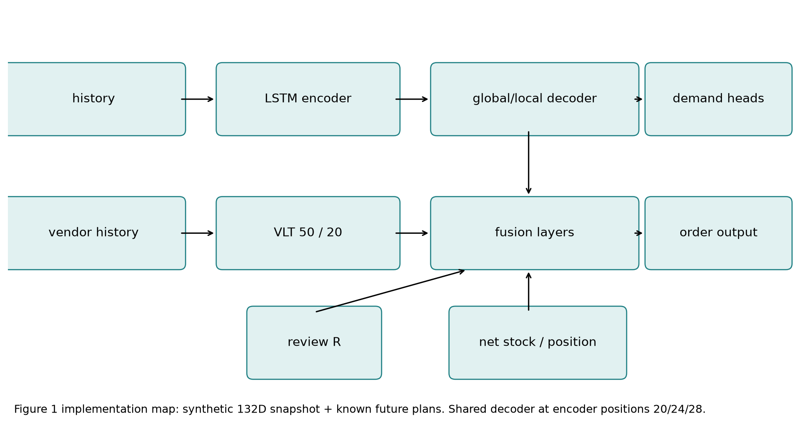

### figure2

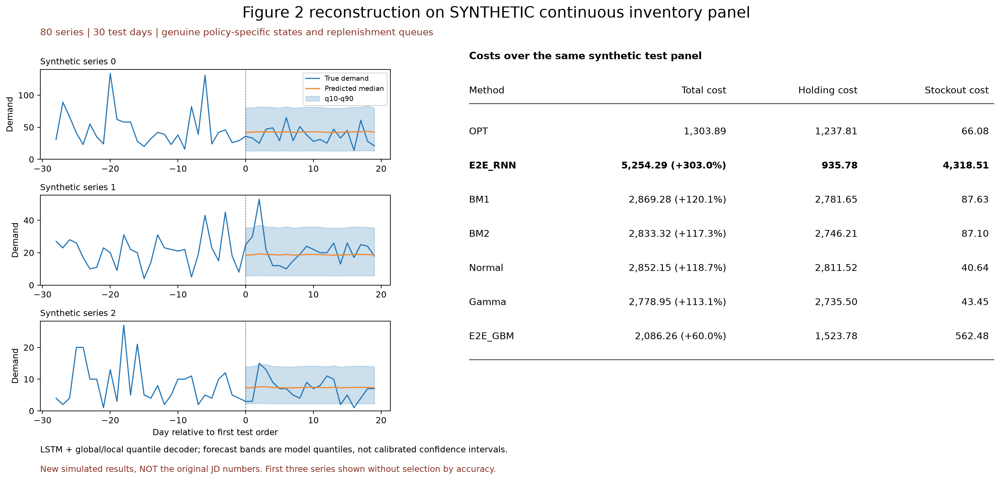

### 离线七种方法：真实运行成本，SYNTHETIC

[CSV](tables/costs_main.csv)

 method  holding_cost  stockout_cost  total_cost  turnover_days  stockout_ratio  relative_gap_pct
    OPT   1237.806665      66.082189 1303.888854       2.988386        0.012917          0.000000
E2E_RNN    935.783521    4318.506112 5254.289633       2.391859        0.332917        302.970669
    BM1   2781.650045      87.631300 2869.281344       7.330986        0.020833        120.055669
    BM2   2746.214318      87.102516 2833.316834       7.221181        0.022500        117.297420
 Normal   2811.518839      40.635487 2852.154326       7.100862        0.009167        118.742136
  Gamma   2735.502278      43.447185 2778.949463       6.938251        0.011250        113.127787
E2E_GBM   1523.778201     562.480444 2086.258646       3.902274        0.086667         60.002798

### Table 1：原文类别明细转录（描述信息，不是模型运行结果）

[CSV](tables/table1_paper_categories_reference.csv)

        second_level_category third_level_category                                             source
                      Tea set  Tea set combination Paper Table 1, p.767, reference transcription only
                      Tea set              Tea cup Paper Table 1, p.767, reference transcription only
                      Tea set           Tea kettle Paper Table 1, p.767, reference transcription only
                      Tea set             Tea tray Paper Table 1, p.767, reference transcription only
                      Tea set              Tea can Paper Table 1, p.767, reference transcription only
                      Tea set             Tea bowl Paper Table 1, p.767, reference transcription only
                      Tea set      Tea accessories Paper Table 1, p.767, reference transcription only
                      Tea set  Tea-ware decoration Paper Table 1, p.767, reference transcription only
                      Tea set           Coffee set Paper Table 1, p.767, reference transcription only
                      Tea set       Tea travel set Paper Table 1, p.767, reference transcription only
Pastry essentials & seasoning      Baking supplies Paper Table 1, p.767, reference transcription only
Pastry essentials & seasoning                Flour Paper Table 1, p.767, reference transcription only
Pastry essentials & seasoning         Mixed grains Paper Table 1, p.767, reference transcription only
Pastry essentials & seasoning                 Rice Paper Table 1, p.767, reference transcription only
Pastry essentials & seasoning                  Oil Paper Table 1, p.767, reference transcription only
Pastry essentials & seasoning           Seasonings Paper Table 1, p.767, reference transcription only
Pastry essentials & seasoning            Dry foods Paper Table 1, p.767, reference transcription only
Pastry essentials & seasoning    Convenience foods Paper Table 1, p.767, reference transcription only

### 附加统计：本工程合成类别计数，不等同于原文Table 1

[CSV](tables/table1_synthetic_composition.csv)

 category  n_series
        0        13
        1        16
        2        18
        3        14
        4         8
        5        11

### Table B.1 对应：论文与重建超参数对照

[CSV](tables/table_B1_hyperparameters.csv)

              parameter                        paper_reference paper_reported_range                                      implementation
      MQRNN hidden size                                     50          30,40,50,60                                                  50
             VLT layers                                  50,20   100/20;50/20;30/20                                               50,20
     Integration layers                                100,100 1/2/3/4 layers of100                                             100,100
          Learning rate                                  0.001    0.0001,0.001,0.01                                               0.001
    Learning-rate decay                                   1e-4       1e-5,1e-4,1e-3                             0; no decay in this run
               Momentum                                   0.85         0.8,0.85,0.9                 0.85 if SGD; not applicable to Adam
        Mini-batch size                                     64           64,128,256                                                 128
         Initialization                       Gaussian(0,0.01)     Gaussian,Uniform          Gaussian(0,0.01); output biases calibrated
             Activation                                   ReLU            ReLU,tanh ReLU; softplus positive output; standard LSTM gates
                Dropout                                    0.2      0.1,0.2,0.3,0.4                                                 0.2
              Optimizer                   SGD family discussed   details incomplete                                                adam
                 Epochs                           not reported         not reported                                                   2
       Forecast horizon                           not reported         not reported                                                  20
              Quantiles                count ambiguity in text     see paper sec4.2                 0.1,0.5,0.6,0.7,0.8,0.9,0.95 + mean
Loss and lambda weights generic losses; small positive lambdas        not specified            SmoothL1 + 0.1 demand loss + 0.1 VLT MSE

## 模型与公式对应

式(1)—(3)：以逐日持有成本和缺货成本构成多期目标，并维护净库存与订单到货队列；本文实现学习策略而非声称精确求解所有随机动态规划。式(4)—(6)：在离线无订单交叉条件下，用实际未来需求构造条件事后最优订货标签，训练时使用已成熟标签；独立线性规划测试验证其有限时域OPT。式(7)：Normal 使用随机提前期方差项；式(8)：Gamma 使用形状—尺度参数近似。式(9)—(10)：BM1累计需求分位数订货与BM2逐日预测路径的多期成本最优化。式(11)：含截距及干预前协变量的处理组回归；后续DID按原商品ID聚类。现场混合积欠/丢失销售是依据正文描述单独定义的模拟规则。原文推导和识别假设的解释见项目根目录 docs/公式与代码对应.md。

## 论文未公开细节与本工程的明确选择

作者包缺少完整训练面板、原神经网络训练源码、权重及全部超参数。此处独立实现LSTM的MQ-RNN、全局/共享局部解码器、三个训练fork、VLT 50→20网络、100→100融合网络及真实LightGBM。累计需求分位数由单独监督头学习，没有把每日分位数直接相加。132维输入的组成是本工程公开定义，不声称与私有特征完全相同。预测跨度20天、SmoothL1订货损失加预测/VLT辅助损失及其权重、7个预测分位点加均值、Adam、批量256均是公开记录的重建选择；默认训练轮数见配置。论文未报告的选择不作为原作者设定。

## 时间顺序、信息集与期末效应

定标只用第0—119天；训练标签最晚第279天，验证标签最晚第329天，测试第330—359天。在线输入只含已发生需求、已完成供应商记录、静态属性及事先已知促销/日历。当前与下一单真实提前期只进入训练标签或模拟器，不作为在线预测特征。每个策略执行到货→订货→需求→计费，不重置历史缺货，订货非负。OPT截断最后到货区间，BM截断保护期，平稳策略没有专门终端价值训练，因此与OPT差距包含期末效应，不能全部归因于模型预测质量。

### field_v4_comparison

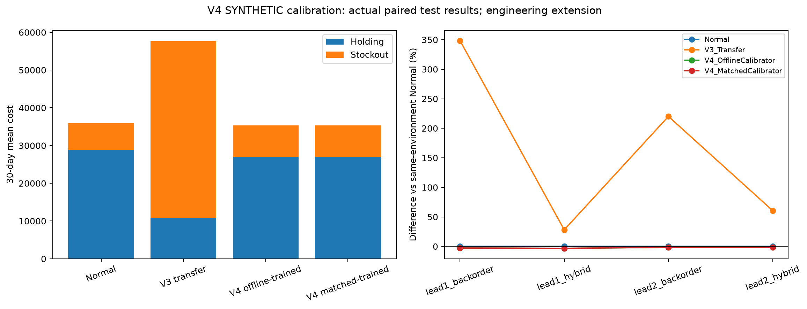

### figure3_matching

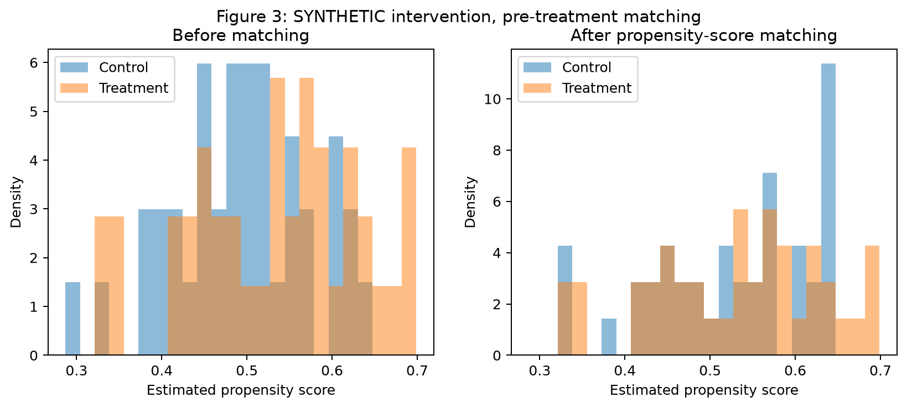

### figureB1_data_size

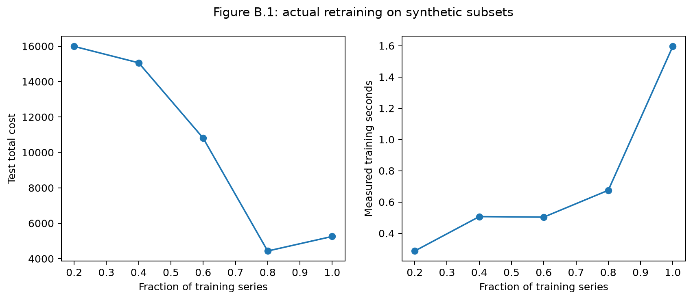

### figureB2_cost_ratio

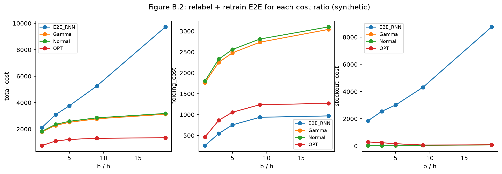

### figureB3_initialization

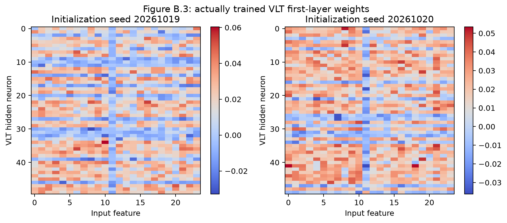

### offline_costs

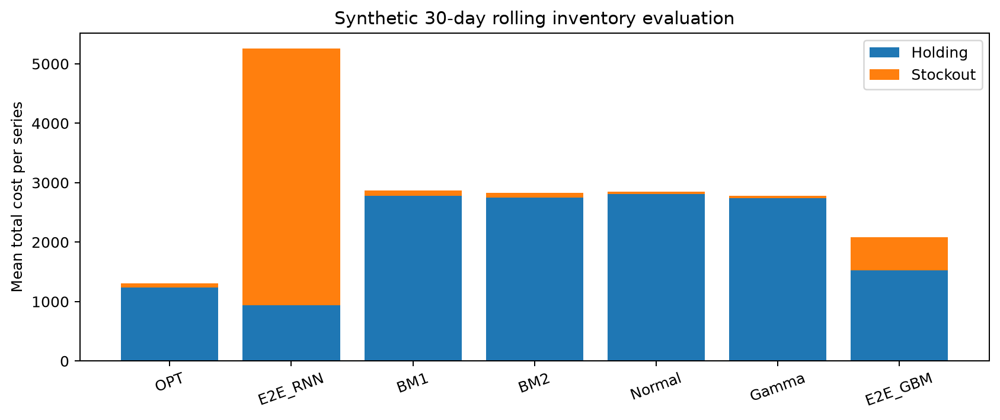

### sensitivity_hidden

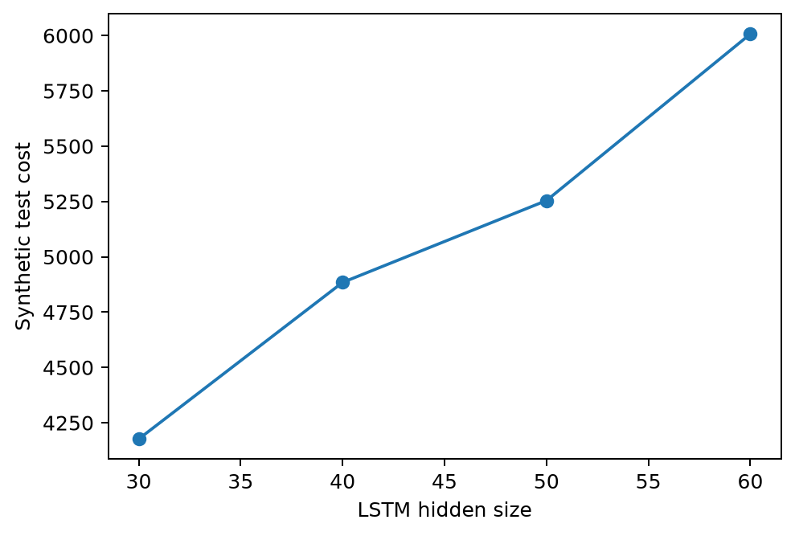

### sensitivity_layers

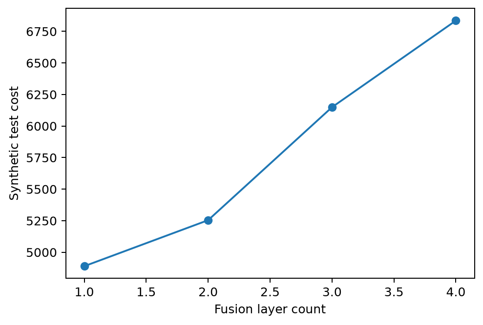

### sensitivity_lr

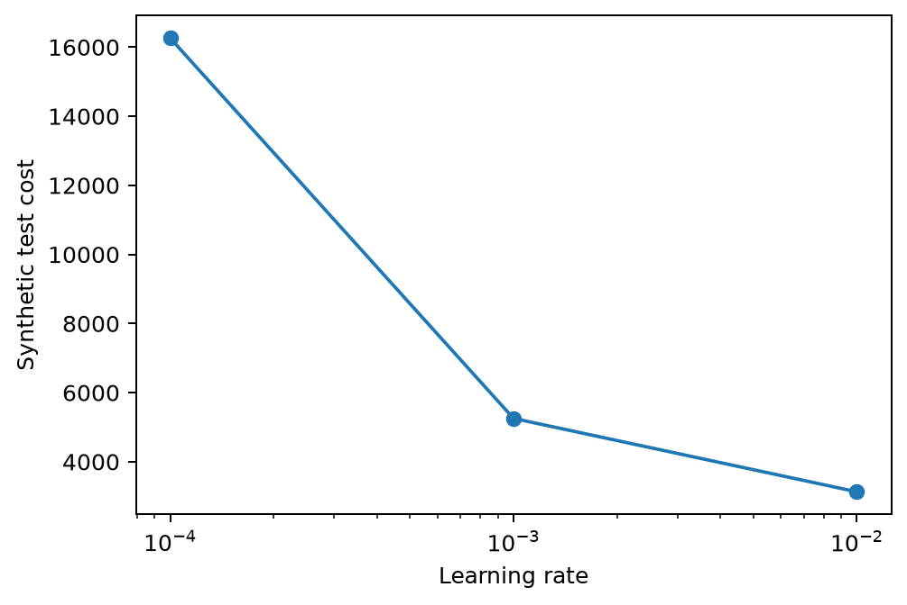

### training_curves

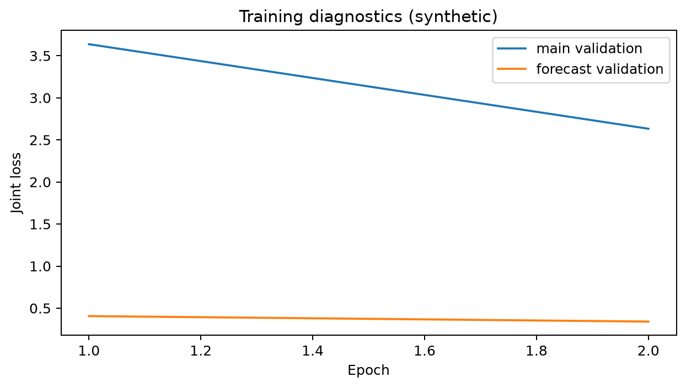

### Table B.2 层数

[CSV](tables/table_B2_layers.csv)

 value  method  holding_cost  stockout_cost  total_cost  turnover_days  stockout_ratio  relative_gap_pct  train_seconds  training_series  training_samples  best_epoch
     1 E2E_RNN   1061.799533    3827.966997 4889.766530       2.717401        0.302917        275.014060       1.611316               80              1932           2
     2 E2E_RNN    935.783521    4318.506112 5254.289633       2.391859        0.332917        302.970669       1.595621               80              1932           2
     3 E2E_RNN    770.990878    5378.340349 6149.331227       2.002389        0.390000        371.614678       1.044914               80              1932           2
     4 E2E_RNN    693.776928    6141.653899 6835.430827       1.814056        0.420833        424.234163       0.858598               80              1932           2

### Table B.3 隐藏单元

[CSV](tables/table_B3_neurons.csv)

 value  method  holding_cost  stockout_cost  total_cost  turnover_days  stockout_ratio  relative_gap_pct  train_seconds  training_series  training_samples  best_epoch
    30 E2E_RNN   1236.093822    2940.548350 4176.642172       3.111492        0.251667        220.321948       0.808075               80              1932           2
    40 E2E_RNN   1030.709533    3853.545183 4884.254716       2.605421        0.308750        274.591339       0.871292               80              1932           2
    50 E2E_RNN    935.783521    4318.506112 5254.289633       2.391859        0.332917        302.970669       1.595621               80              1932           2
    60 E2E_RNN    801.416379    5205.685355 6007.101733       2.063986        0.380000        360.706579       0.796997               80              1932           2

### Table B.4 学习率

[CSV](tables/table_B4_learning_rate.csv)

 value  method  holding_cost  stockout_cost   total_cost  turnover_days  stockout_ratio  relative_gap_pct  train_seconds  training_series  training_samples  best_epoch
0.0001 E2E_RNN    279.161210   15982.630600 16261.791810       0.743959        0.692500       1147.176226       0.794068               80              1932           2
0.0010 E2E_RNN    935.783521    4318.506112  5254.289633       2.391859        0.332917        302.970669       1.595621               80              1932           2
0.0100 E2E_RNN    817.639796    2311.336830  3128.976627       2.070904        0.281250        139.972649       0.918163               80              1932           2

### Table B.5 数据量

[CSV](tables/table_B5_data_size.csv)

 value  method  holding_cost  stockout_cost   total_cost  turnover_days  stockout_ratio  relative_gap_pct  train_seconds  training_series  training_samples  best_epoch
   0.2 E2E_RNN    285.424134   15701.679112 15987.103246       0.760416        0.686250       1126.109357       0.286499               16               386           2
   0.4 E2E_RNN    304.705068   14756.224178 15060.929246       0.810150        0.670417       1055.077689       0.506543               32               780           2
   0.6 E2E_RNN    445.515822   10362.958212 10808.474035       1.179739        0.559167        728.941363       0.503349               48              1190           2
   0.8 E2E_RNN   1257.288411    3175.762978  4433.051390       3.143990        0.257917        239.986907       0.674932               64              1554           2
   1.0 E2E_RNN    935.783521    4318.506112  5254.289633       2.391859        0.332917        302.970669       1.595621               80              1932           2

### Table B.6 初始化

[CSV](tables/table_B6_initialization.csv)

   value  method  holding_cost  stockout_cost  total_cost  turnover_days  stockout_ratio  relative_gap_pct  train_seconds  training_series  training_samples  best_epoch
20261019 E2E_RNN    935.783521    4318.506112 5254.289633       2.391859        0.332917        302.970669       1.595621               80              1932           2
20261020 E2E_RNN    979.782717    4060.000485 5039.783202       2.484235        0.324583        286.519387       0.767720               80              1932           2

### Figure B.2 成本比对应数据

[CSV](tables/table_cost_ratio.csv)

 value  method  holding_cost  stockout_cost  total_cost  turnover_days  stockout_ratio  relative_gap_pct  train_seconds  training_series
   1.0     OPT    462.338957     291.884132  754.223089       1.129161        0.352500          0.000000       0.912752               80
   1.0 E2E_RNN    257.508146    1856.330827 2113.838974       0.686336        0.712500        180.267073       0.912752               80
   1.0  Normal   1804.224522      24.813022 1829.037543       4.545767        0.053750        142.506172       0.912752               80
   1.0   Gamma   1764.191884      26.944130 1791.136014       4.436894        0.057917        137.480931       0.912752               80
   3.0     OPT    862.519165     233.789896 1096.309062       2.078097        0.147083          0.000000       0.910640               80
   3.0 E2E_RNN    544.800015    2547.379615 3092.179630       1.421307        0.490833        182.053641       0.910640               80
   3.0  Normal   2328.670609      25.289832 2353.960441       5.877979        0.020417        114.716864       0.910640               80
   3.0   Gamma   2252.080204      29.273339 2281.353543       5.692164        0.023333        108.094015       0.910640               80
   5.0     OPT   1057.106665     162.212327 1219.318993       2.527294        0.072917          0.000000       0.908790               80
   5.0 E2E_RNN    753.897701    3007.311800 3761.209500       1.946321        0.396667        208.468048       0.908790               80
   5.0  Normal   2561.081614      29.790530 2590.872144       6.466820        0.013750        112.485179       0.908790               80
   5.0   Gamma   2480.546899      33.107555 2513.654454       6.280869        0.015000        106.152325       0.908790               80
   9.0     OPT   1237.806665      66.082189 1303.888854       2.988386        0.012917          0.000000       1.595621               80
   9.0 E2E_RNN    935.783521    4318.506112 5254.289633       2.391859        0.332917        302.970669       1.595621               80
   9.0  Normal   2811.518839      40.635487 2852.154326       7.100862        0.009167        118.742136       1.595621               80
   9.0   Gamma   2735.502278      43.447185 2778.949463       6.938251        0.011250        113.127787       1.595621               80
  19.0     OPT   1269.431665      79.656843 1349.088509       3.047120        0.007500          0.000000       1.014219               80
  19.0 E2E_RNN    969.275320    8758.852753 9728.128074       2.473760        0.324583        621.088944       1.014219               80
  19.0  Normal   3102.520786      79.968461 3182.489246       7.836381        0.008333        135.899218       1.014219               80
  19.0   Gamma   3042.810086      80.504982 3123.315068       7.731072        0.008750        131.512984       1.014219               80

### Table 2 模拟干预处理—对照

[CSV](tables/table2_synthetic_field.csv)

        metric  treatment_mean  control_mean   difference  relative_change_pct  p_clustered  p_welch_descriptive  p_student_descriptive  matched_pairs
  holding_cost    30235.930298  35178.822311 -4942.892013           -14.050760     0.610233             0.358002               0.358001             41
 stockout_cost     9773.977779   4079.265107  5694.712671           139.601436     0.052406             0.053400               0.051146             41
    total_cost    40009.908077  39258.087419   751.820658             1.915072     0.940185             0.904350               0.904327             41
 turnover_days        4.423459      4.329668     0.093791             2.166239     0.821265             0.779027               0.778951             41
stockout_ratio        0.095122      0.077236     0.017886            23.157895     0.404214             0.371407               0.371247             41

### Table 3 含截距控制变量回归

[CSV](tables/table3_synthetic_regression.csv)

        metric       term  coefficient  standard_error_clustered  p_clustered
  holding_cost      const  5329.515422               5362.446771 3.202916e-01
  holding_cost    treated   942.134369               2761.603083 7.329870e-01
  holding_cost pre_demand  1373.961017                136.381080 7.167854e-24
  holding_cost   pre_lead   -44.445659                876.780209 9.595710e-01
 stockout_cost      const   979.223732               4548.889609 8.295595e-01
 stockout_cost    treated  6280.118031               3243.228811 5.282138e-02
 stockout_cost pre_demand   131.475366                115.997598 2.570330e-01
 stockout_cost   pre_lead    42.959335                905.167366 9.621465e-01
    total_cost      const  6308.739154               6361.130596 3.213128e-01
    total_cost    treated  7222.252400               3911.004962 6.479806e-02
    total_cost pre_demand  1505.436383                226.501329 3.001867e-11
    total_cost   pre_lead    -1.486324               1102.550560 9.989244e-01
 turnover_days      const     4.697120                  0.874872 7.920828e-08
 turnover_days    treated     0.014287                  0.376914 9.697633e-01
 turnover_days pre_demand    -0.019984                  0.010407 5.483709e-02
 turnover_days   pre_lead     0.013566                  0.180179 9.399840e-01
stockout_ratio      const     0.075577                  0.045700 9.818017e-02
stockout_ratio    treated     0.017253                  0.022402 4.412049e-01
stockout_ratio pre_demand    -0.000341                  0.000528 5.180193e-01
stockout_ratio   pre_lead     0.001768                  0.010100 8.610122e-01

### Table 4 两期DID

[CSV](tables/table4_synthetic_did.csv)

        metric  treatment_pre  treatment_post  control_pre  control_post          did  standard_error_clustered  p_clustered
  holding_cost   43829.047533    30235.930298 46980.143680  35178.822311 -1791.795866               4617.217731     0.697965
 stockout_cost     237.855399     9773.977779   121.097637   4079.265107  5577.954909               2903.422621     0.054711
    total_cost   44066.902932    40009.908077 47101.241317  39258.087419  3786.159043               5093.673951     0.457296
 turnover_days       8.229208        4.423459     7.423692      4.329668    -0.711725                  0.625280     0.255016
stockout_ratio       0.006504        0.095122     0.006504      0.077236     0.017886                  0.021166     0.398089

### 匹配前后协变量平衡

[CSV](tables/field_covariate_balance.csv)

      variable  SMD_before  SMD_after
log_pre_demand    0.315777  -0.207918
      pre_lead   -0.230288  -0.342030

## 模拟现场实验的解释边界

这是模拟干预而非京东现场。第300—329天预热、330—359天干预前、360—369天过渡，连续传递库存和在途订单，370天切换策略并观察至399天。PSM只用干预前变量，有放回匹配按原商品ID聚类。V4校准成本训练220—279，编码器信息截至329，两个校准头均按330—359同一现场验证环境选轮次。匹配头训练/验证/测试均采用2—8天与hybrid，h=12、b=88；另一个头仅训练环境不同，作为控制。策略只接收可观测库存与在途总量，实际未来到货日只用于模拟器。假定包括未满足需求在内的真实历史需求可观测。现场费用按每商品30天求和；Normal替代京东私有算法，共享模型替代原文分品类训练。两期DID不能检验平行趋势，合成显著性不证明真实业务因果效果。

## 作者披露数据：独立保留的原口径

author_disclosed 子目录按作者公开notebook口径重算现有预测和现场样本，data/author保留原始CSV。该口径存在负补货、库存处理和Normal方差等问题，详见 docs/作者数据与口径.md，不能与修正后的新模拟成本混为一谈。数据量和截取窗口也不同于论文整体现有结果，因此仍不会逐项等于原Figure 2。

## 如何重复与核验

在项目根目录执行 python run_full.py --profile standard --stage all。quick用于安装验证；large生成一万条序列。训练、验证、测试、敏感性、现场、图表和报告可按stage运行。数据与模型有签名，设置改变会拒绝误用缓存，使用不同目录或--force明确重跑。测试执行 python -m unittest discover -s tests -v。模型权重、每轮训练日志、分位点验证选择、逐商品成本、逐日库存、逐单到货、匹配样本与回归系数均保存，便于检查每一项结果。

## 完整性检查

本次目录应有的 15 张主表/附录表：已生成 15 张。完整性清单见 logs/coverage_manifest.json。该检查只证明产物存在，数学、时间顺序和结果来源还须结合测试与协议核验。
