# Qi 2023：V4现场训练与评估修正报告（合成数据）

## 本次结果的含义

本工程覆盖论文主要公式、预测与决策模型、多期离线评估、参数和数据量敏感性分析，以及模拟干预的匹配、回归、双重差分流程。完整训练实验使用自生成数据；作者披露数据另行计算。它是可运行的方法重建，不能等同于原始京东数据上的逐数值精确复现，也不能替代论文原始实地实验。

## V4现场修正的性质

离线模型及附录实验保留V3结果，新增两个现场校准模型。匹配模型在2—8天提前期、可能交叉、混合积欠/丢失销售环境中，以实际滚动成本训练；原闭式标签未用于这个环境。校准头冻结离线MQ-RNN表示并修正Normal基库存目标，这是工程扩展，不是原作者现场神经网络的精确恢复。

## V4同商品测试：改进与仍未解决的差距

全部商品配对比较：Normal成本34868.01，旧迁移策略43452.30，新匹配校准策略40757.70。新版相对旧迁移策略变化-6.20%，相对Normal变化+16.89%。因此即使训练条件已修正，仍不能声称恢复了论文现场降本结论；其他控制策略及独立面板也全部公开。

## 实际数据与运行环境

配置 standard；2,000 个合成商品—仓库序列 × 420 天 = 840,000 行日需求；训练样本 47,806，验证样本 8,975。随机种子 20261019。设备 cuda，NVIDIA GeForce RTX 4060 Laptop GPU。本次入口用时 153.6 秒（重用缓存时不代表原训练总时长，逐模型时间见 tables/train 与 logs/model）。每个非默认设置均实际重新训练，最优轮次由验证集选择。

## 实际结论：包括未复现的结果

离线E2E平均30天总成本2042.07，Normal为2814.61，相对变化-27.45%。模拟现场处理组总成本46933.17，对照组40077.27，相对变化+17.11%。本次模拟现场没有重现论文的总成本下降结论；程序执行通过不代表论文所有实证结论已得到重复支持。

## 如何读新版现场比较

下面是同一批商品、同一需求和初始库存/在途订单的配对比较，不能与后面的匹配组均值混算。V3迁移、离线条件校准、匹配条件校准和Normal全部保留。旧测试期已用于问题诊断，属于探索评估；额外三组固定独立面板仅用于评估，没有按结果选权重。训练条件匹配不保证测试成本更低。

### V4：四种环境×四种策略的固定配对实验

[CSV](tables/field_v4_factorial.csv)

    environment               policy  holding_cost  stockout_cost   total_cost  stockout_ratio  relative_to_Normal_pct  paired_difference  paired_ci_low  paired_ci_high  n_series
lead1_backorder               Normal  24765.472217    5035.609598 29801.081815        0.083267                0.000000           0.000000       0.000000        0.000000      2000
lead1_backorder          V3_Transfer  15754.213880   16482.576119 32236.790000        0.211250                8.173221        2435.708184    1928.669043     2942.747326      2000
lead1_backorder V4_OfflineCalibrator  13604.727990   20272.719530 33877.447520        0.258183               13.678583        4076.365705    3536.377656     4616.353753      2000
lead1_backorder V4_MatchedCalibrator  12183.924553   25498.905711 37682.830264        0.298933               26.447860        7881.748449    7176.990685     8586.506212      2000
   lead1_hybrid               Normal  24765.472217    4613.608362 29379.080579        0.083183                0.000000           0.000000       0.000000        0.000000      2000
   lead1_hybrid          V3_Transfer  15907.452607   12951.998179 28859.450786        0.208283               -1.768707        -519.629793    -850.331615     -188.927971      2000
   lead1_hybrid V4_OfflineCalibrator  13752.052480   15821.523601 29573.576081        0.254450                0.662020         194.495502    -194.333296      583.324300      2000
   lead1_hybrid V4_MatchedCalibrator  12350.271364   18462.048646 30812.320010        0.293717                4.878435        1433.239431     982.505106     1883.973756      2000
lead2_backorder               Normal  27393.681901    7498.468309 34892.150210        0.099450                0.000000           0.000000       0.000000        0.000000      2000
lead2_backorder          V3_Transfer  15486.846001   29397.865041 44884.711042        0.275467               28.638421        9992.560832    8932.987738    11052.133926      2000
lead2_backorder V4_OfflineCalibrator  16789.117735   22871.385781 39660.503516        0.242417               13.665977        4768.353306    4032.235645     5504.470967      2000
lead2_backorder V4_MatchedCalibrator  15693.078482   26239.611213 41932.689695        0.265850               20.178004        7040.539485    6209.760338     7871.318633      2000
   lead2_hybrid               Normal  27393.681901    7474.326942 34868.008843        0.099450                0.000000           0.000000       0.000000        0.000000      2000
   lead2_hybrid          V3_Transfer  15522.158244   27930.139861 43452.298105        0.274717               24.619385        8584.289262    7618.621602     9549.956921      2000
   lead2_hybrid V4_OfflineCalibrator  16801.079748   22233.613990 39034.693738        0.242100               11.949879        4166.684895    3452.407159     4880.962631      2000
   lead2_hybrid V4_MatchedCalibrator  15711.650403   25046.046095 40757.696498        0.265317               16.891379        5889.687655    5111.383070     6667.992240      2000

### V4：三个固定独立面板的额外评估

[CSV](tables/independent_holdout_summary.csv)

 panel_seed               policy  n_series   total_cost  holding_cost  stockout_cost  stockout_ratio  relative_to_Normal_pct  paired_difference  paired_ci_low  paired_ci_high
   20261020               Normal      1000 34042.030078  27010.077036    7031.953042        0.099367                0.000000           0.000000       0.000000        0.000000
   20261020          V3_Transfer      1000 42915.947353  15256.864720   27659.082633        0.275067               26.067533        8873.917275    7528.479034    10219.355516
   20261020 V4_OfflineCalibrator      1000 38564.005936  16629.996146   21934.009790        0.241500               13.283508        4521.975857    3601.094917     5442.856797
   20261020 V4_MatchedCalibrator      1000 40309.679214  15538.233838   24771.445376        0.267367               18.411502        6267.649136    5235.436470     7299.861802
   20261021               Normal      1000 34836.408113  27793.101847    7043.306266        0.092067                0.000000           0.000000       0.000000        0.000000
   20261021          V3_Transfer      1000 42395.298260  15834.971141   26560.327119        0.267467               21.698248        7558.890147    6276.008998     8841.771295
   20261021 V4_OfflineCalibrator      1000 38444.252208  17029.127055   21415.125152        0.236733               10.356533        3607.844094    2615.010795     4600.677394
   20261021 V4_MatchedCalibrator      1000 40093.662410  15894.869399   24198.793011        0.260500               15.091264        5257.254297    4185.360399     6329.148195
   20261022               Normal      1000 35935.602491  28004.212162    7931.390329        0.098033                0.000000           0.000000       0.000000        0.000000
   20261022          V3_Transfer      1000 44111.139845  16072.787461   28038.352384        0.270300               22.750523        8175.537354    6757.143352     9593.931357
   20261022 V4_OfflineCalibrator      1000 39938.599553  17226.757863   22711.841689        0.240233               11.139363        4002.997062    2951.843177     5054.150947
   20261022 V4_MatchedCalibrator      1000 41852.952004  16040.247662   25812.704342        0.265367               16.466538        5917.349514    4694.756834     7139.942194

## 先看哪些结果

Figure 2 展示固定前三个商品的真实需求、神经网络预测中位数、10%—90%预测分位带，以及七种方法的实际模拟库存成本。阴影是需求预测分位带，不是均值置信区间。成本表由全部测试商品汇总，每种策略独立滚动自己的库存和在途订单；不按效果挑选商品，不把原论文数值填进模拟结果。

### figure1_architecture

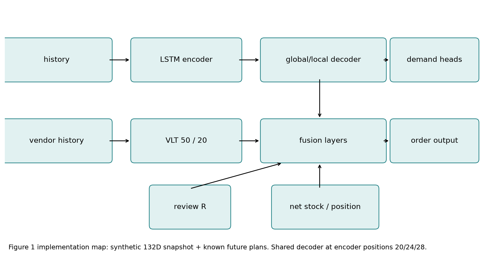

### figure2

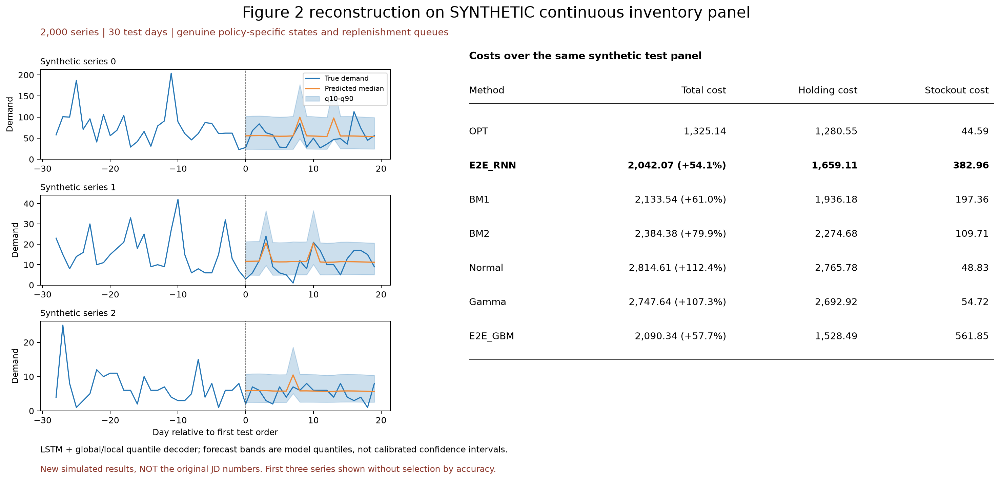

### 离线七种方法：真实运行成本，SYNTHETIC

[CSV](tables/costs_main.csv)

 method  holding_cost  stockout_cost  total_cost  turnover_days  stockout_ratio  relative_gap_pct
    OPT   1280.554036      44.589312 1325.143348       3.074285        0.012467          0.000000
E2E_RNN   1659.109161     382.964749 2042.073911       4.182670        0.081650         54.102114
    BM1   1936.183264     197.360004 2133.543267       4.898227        0.049700         61.004715
    BM2   2274.675218     109.705890 2384.381108       5.882006        0.026650         79.933825
 Normal   2765.775696      48.831565 2814.607260       6.930809        0.013483        112.400210
  Gamma   2692.916244      54.719916 2747.636160       6.772393        0.014850        107.346335
E2E_GBM   1528.486844     561.852892 2090.339736       3.844596        0.105750         57.744424

### Table 1：原文类别明细转录（描述信息，不是模型运行结果）

[CSV](tables/table1_paper_categories_reference.csv)

        second_level_category third_level_category                                             source
                      Tea set  Tea set combination Paper Table 1, p.767, reference transcription only
                      Tea set              Tea cup Paper Table 1, p.767, reference transcription only
                      Tea set           Tea kettle Paper Table 1, p.767, reference transcription only
                      Tea set             Tea tray Paper Table 1, p.767, reference transcription only
                      Tea set              Tea can Paper Table 1, p.767, reference transcription only
                      Tea set             Tea bowl Paper Table 1, p.767, reference transcription only
                      Tea set      Tea accessories Paper Table 1, p.767, reference transcription only
                      Tea set  Tea-ware decoration Paper Table 1, p.767, reference transcription only
                      Tea set           Coffee set Paper Table 1, p.767, reference transcription only
                      Tea set       Tea travel set Paper Table 1, p.767, reference transcription only
Pastry essentials & seasoning      Baking supplies Paper Table 1, p.767, reference transcription only
Pastry essentials & seasoning                Flour Paper Table 1, p.767, reference transcription only
Pastry essentials & seasoning         Mixed grains Paper Table 1, p.767, reference transcription only
Pastry essentials & seasoning                 Rice Paper Table 1, p.767, reference transcription only
Pastry essentials & seasoning                  Oil Paper Table 1, p.767, reference transcription only
Pastry essentials & seasoning           Seasonings Paper Table 1, p.767, reference transcription only
Pastry essentials & seasoning            Dry foods Paper Table 1, p.767, reference transcription only
Pastry essentials & seasoning    Convenience foods Paper Table 1, p.767, reference transcription only

### 附加统计：本工程合成类别计数，不等同于原文Table 1

[CSV](tables/table1_synthetic_composition.csv)

 category  n_series
        0       323
        1       376
        2       328
        3       322
        4       332
        5       319

### Table B.1 对应：论文与重建超参数对照

[CSV](tables/table_B1_hyperparameters.csv)

              parameter                        paper_reference paper_reported_range                                      implementation
      MQRNN hidden size                                     50          30,40,50,60                                                  50
             VLT layers                                  50,20   100/20;50/20;30/20                                               50,20
     Integration layers                                100,100 1/2/3/4 layers of100                                             100,100
          Learning rate                                  0.001    0.0001,0.001,0.01                                               0.001
    Learning-rate decay                                   1e-4       1e-5,1e-4,1e-3                             0; no decay in this run
               Momentum                                   0.85         0.8,0.85,0.9                 0.85 if SGD; not applicable to Adam
        Mini-batch size                                     64           64,128,256                                                 256
         Initialization                       Gaussian(0,0.01)     Gaussian,Uniform          Gaussian(0,0.01); output biases calibrated
             Activation                                   ReLU            ReLU,tanh ReLU; softplus positive output; standard LSTM gates
                Dropout                                    0.2      0.1,0.2,0.3,0.4                                                 0.2
              Optimizer                   SGD family discussed   details incomplete                                                adam
                 Epochs                           not reported         not reported                                                  10
       Forecast horizon                           not reported         not reported                                                  20
              Quantiles                count ambiguity in text     see paper sec4.2                 0.1,0.5,0.6,0.7,0.8,0.9,0.95 + mean
Loss and lambda weights generic losses; small positive lambdas        not specified            SmoothL1 + 0.1 demand loss + 0.1 VLT MSE

## 模型与公式对应

式(1)—(3)：以逐日持有成本和缺货成本构成多期目标，并维护净库存与订单到货队列；本文实现学习策略而非声称精确求解所有随机动态规划。式(4)—(6)：在离线无订单交叉条件下，用实际未来需求构造条件事后最优订货标签，训练时使用已成熟标签；独立线性规划测试验证其有限时域OPT。式(7)：Normal 使用随机提前期方差项；式(8)：Gamma 使用形状—尺度参数近似。式(9)—(10)：BM1累计需求分位数订货与BM2逐日预测路径的多期成本最优化。式(11)：含截距及干预前协变量的处理组回归；后续DID按原商品ID聚类。现场混合积欠/丢失销售是依据正文描述单独定义的模拟规则。原文推导和识别假设的解释见项目根目录 docs/公式与代码对应.md。

## 论文未公开细节与本工程的明确选择

作者包缺少完整训练面板、原神经网络训练源码、权重及全部超参数。此处独立实现LSTM的MQ-RNN、全局/共享局部解码器、三个训练fork、VLT 50→20网络、100→100融合网络及真实LightGBM。累计需求分位数由单独监督头学习，没有把每日分位数直接相加。132维输入的组成是本工程公开定义，不声称与私有特征完全相同。预测跨度20天、SmoothL1订货损失加预测/VLT辅助损失及其权重、7个预测分位点加均值、Adam、批量256均是公开记录的重建选择；默认训练轮数见配置。论文未报告的选择不作为原作者设定。

## 时间顺序、信息集与期末效应

定标只用第0—119天；训练标签最晚第279天，验证标签最晚第329天，测试第330—359天。在线输入只含已发生需求、已完成供应商记录、静态属性及事先已知促销/日历。当前与下一单真实提前期只进入训练标签或模拟器，不作为在线预测特征。每个策略执行到货→订货→需求→计费，不重置历史缺货，订货非负。OPT截断最后到货区间，BM截断保护期，平稳策略没有专门终端价值训练，因此与OPT差距包含期末效应，不能全部归因于模型预测质量。

### field_v4_comparison

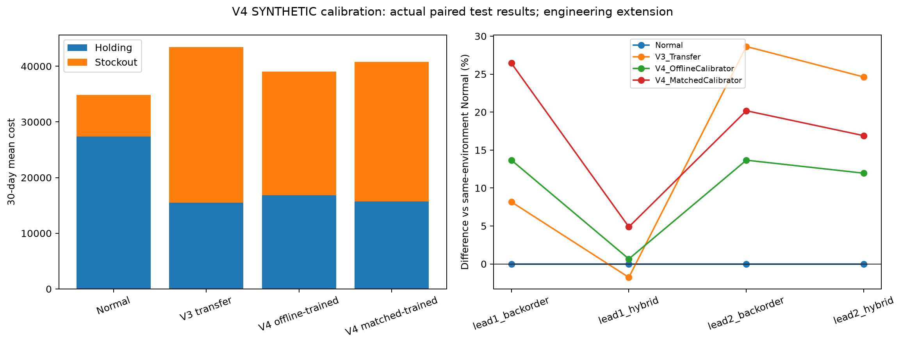

### figure3_matching

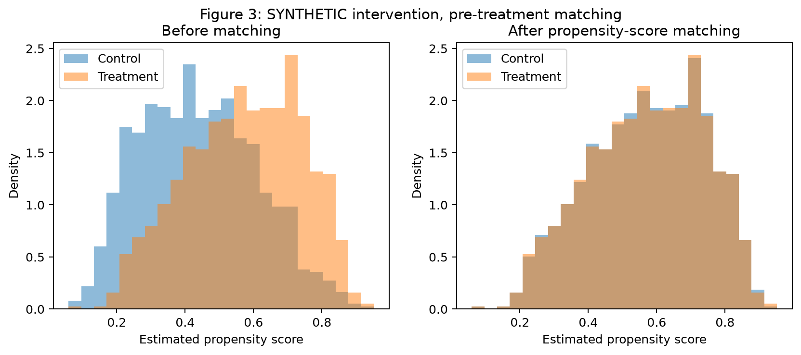

### figureB1_data_size

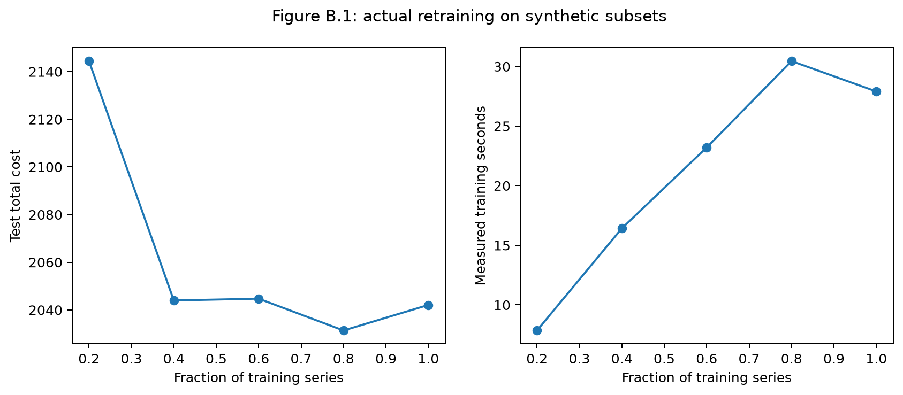

### figureB2_cost_ratio

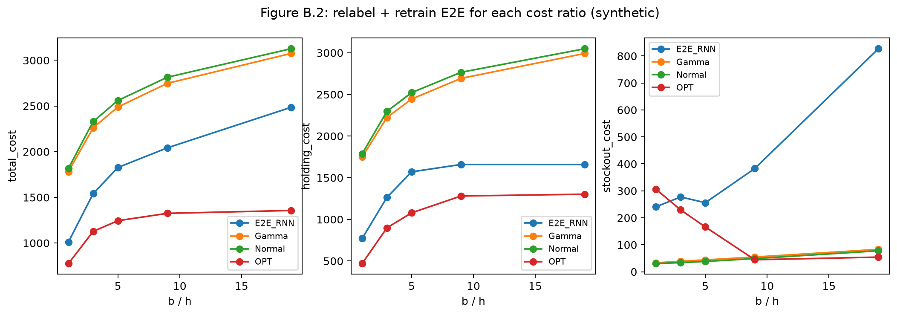

### figureB3_initialization

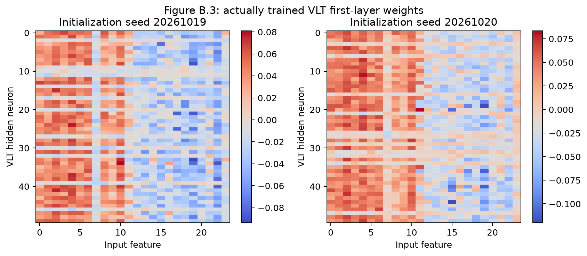

### offline_costs

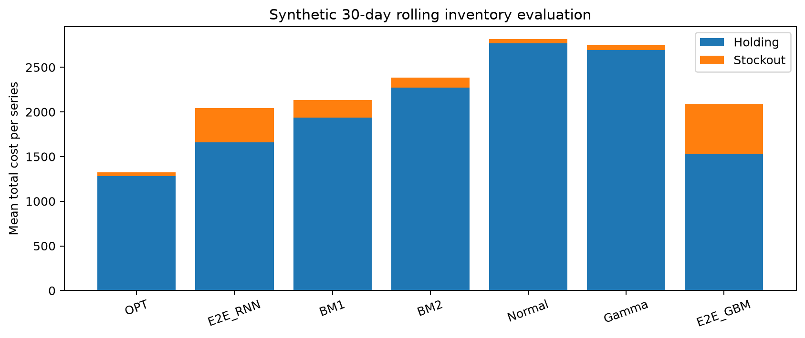

### sensitivity_hidden

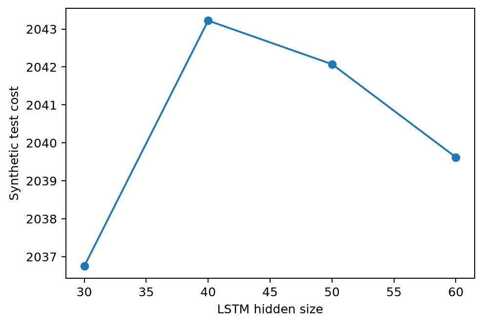

### sensitivity_layers

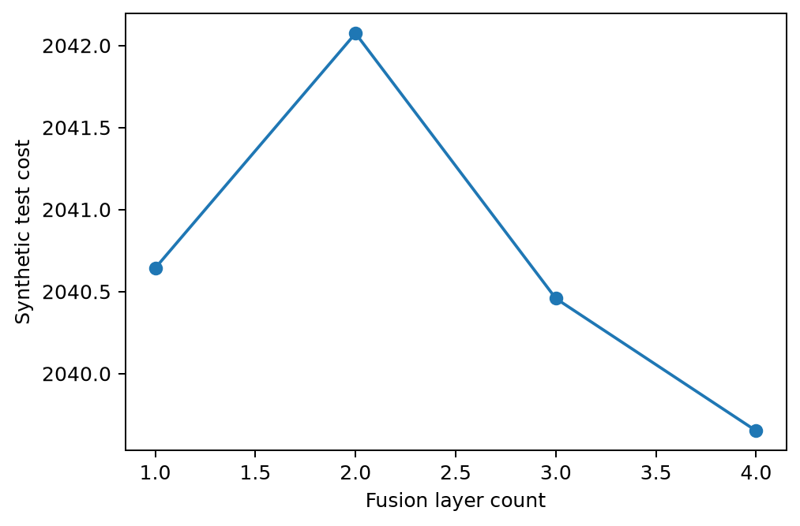

### sensitivity_lr

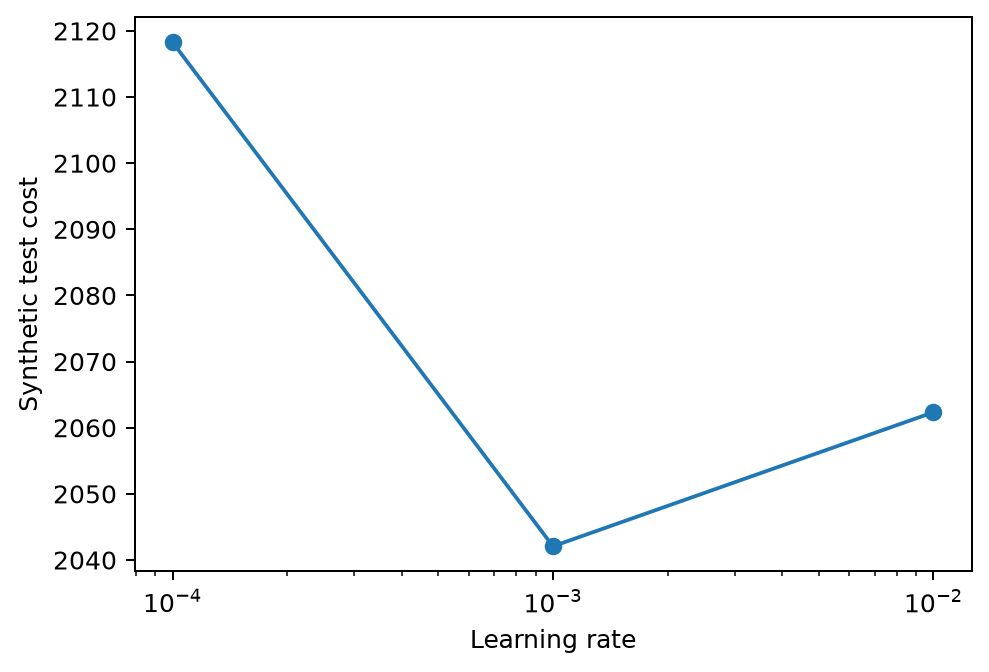

### training_curves

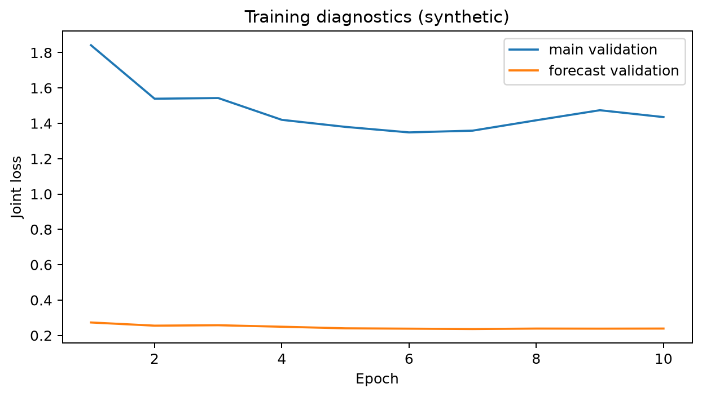

### Table B.2 层数

[CSV](tables/table_B2_layers.csv)

 value  method  holding_cost  stockout_cost  total_cost  turnover_days  stockout_ratio  relative_gap_pct  train_seconds  training_series  training_samples  best_epoch
     1 E2E_RNN   1661.510495     379.132388 2040.642883       4.215212        0.079133         53.994123      50.160611             2000             47806           6
     2 E2E_RNN   1659.109161     382.964749 2042.073911       4.182670        0.081650         54.102114      27.902116             2000             47806           6
     3 E2E_RNN   1651.017056     389.440684 2040.457740       4.170510        0.082333         53.980152      44.516333             2000             47806           5
     4 E2E_RNN   1635.371079     404.280021 2039.651100       4.114880        0.083900         53.919280      47.103280             2000             47806           8

### Table B.3 隐藏单元

[CSV](tables/table_B3_neurons.csv)

 value  method  holding_cost  stockout_cost  total_cost  turnover_days  stockout_ratio  relative_gap_pct  train_seconds  training_series  training_samples  best_epoch
    30 E2E_RNN   1637.201342     399.549101 2036.750443       4.130116        0.084283         53.700386      45.408200             2000             47806           7
    40 E2E_RNN   1660.815842     382.406296 2043.222138       4.179908        0.082250         54.188763      38.711648             2000             47806           7
    50 E2E_RNN   1659.109161     382.964749 2042.073911       4.182670        0.081650         54.102114      27.902116             2000             47806           6
    60 E2E_RNN   1633.134601     406.486044 2039.620645       4.115961        0.085850         53.916982      37.190687             2000             47806           6

### Table B.4 学习率

[CSV](tables/table_B4_learning_rate.csv)

 value  method  holding_cost  stockout_cost  total_cost  turnover_days  stockout_ratio  relative_gap_pct  train_seconds  training_series  training_samples  best_epoch
0.0001 E2E_RNN   1490.669708     627.607116 2118.276824       3.722186        0.110833         59.852655      39.499672             2000             47806          10
0.0010 E2E_RNN   1659.109161     382.964749 2042.073911       4.182670        0.081650         54.102114      27.902116             2000             47806           6
0.0100 E2E_RNN   1676.724612     385.618030 2062.342642       4.202724        0.081483         55.631664      38.201060             2000             47806           9

### Table B.5 数据量

[CSV](tables/table_B5_data_size.csv)

 value  method  holding_cost  stockout_cost  total_cost  turnover_days  stockout_ratio  relative_gap_pct  train_seconds  training_series  training_samples  best_epoch
   0.2 E2E_RNN   1748.588458     395.844197 2144.432656       4.333181        0.078283         61.826466       7.854122              400              9458           8
   0.4 E2E_RNN   1611.007033     432.957499 2043.964532       4.073388        0.088100         54.244787      16.420762              800             19052           9
   0.6 E2E_RNN   1680.549237     364.170490 2044.719727       4.261338        0.077200         54.301776      23.205477             1200             28582           6
   0.8 E2E_RNN   1595.284378     436.081575 2031.365953       4.041848        0.089167         53.294054      30.452882             1600             38100           7
   1.0 E2E_RNN   1659.109161     382.964749 2042.073911       4.182670        0.081650         54.102114      27.902116             2000             47806           6

### Table B.6 初始化

[CSV](tables/table_B6_initialization.csv)

   value  method  holding_cost  stockout_cost  total_cost  turnover_days  stockout_ratio  relative_gap_pct  train_seconds  training_series  training_samples  best_epoch
20261019 E2E_RNN   1659.109161     382.964749 2042.073911       4.182670         0.08165         54.102114      27.902116             2000             47806           6
20261020 E2E_RNN   1651.602756     387.444714 2039.047469       4.153635         0.08315         53.873728      37.761777             2000             47806          10

### Figure B.2 成本比对应数据

[CSV](tables/table_cost_ratio.csv)

 value  method  holding_cost  stockout_cost  total_cost  turnover_days  stockout_ratio  relative_gap_pct  train_seconds  training_series
   1.0     OPT    469.426833     306.135519  775.562353       1.133636        0.356433          0.000000      38.183364             2000
   1.0 E2E_RNN    770.522361     240.760825 1011.283186       1.968533        0.296667         30.393537      38.183364             2000
   1.0  Normal   1787.203504      30.462293 1817.665797       4.444795        0.063017        134.367461      38.183364             2000
   1.0   Gamma   1748.857875      32.993841 1781.851715       4.340397        0.067600        129.749640      38.183364             2000
   3.0     OPT    897.785699     229.458641 1127.244340       2.155215        0.148567          0.000000      37.429971             2000
   3.0 E2E_RNN   1263.607159     277.429945 1541.037105       3.192873        0.149750         36.708347      37.429971             2000
   3.0  Normal   2296.233365      33.857075 2330.090439       5.738989        0.026167        106.706777      37.429971             2000
   3.0   Gamma   2222.692866      39.078226 2261.771092       5.559345        0.029350        100.646037      37.429971             2000
   5.0     OPT   1078.384361     166.131569 1244.515930       2.581173        0.077533          0.000000      37.985348             2000
   5.0 E2E_RNN   1570.850846     256.130150 1826.980995       3.960646        0.092983         46.802540      37.985348             2000
   5.0  Normal   2522.007026      38.292839 2560.299865       6.312292        0.018467        105.726564      37.985348             2000
   5.0   Gamma   2444.797198      43.994609 2488.791807       6.131997        0.020850         99.980711      37.985348             2000
   9.0     OPT   1280.554036      44.589312 1325.143348       3.074285        0.012467          0.000000      27.902116             2000
   9.0 E2E_RNN   1659.109161     382.964749 2042.073911       4.182670        0.081650         54.102114      27.902116             2000
   9.0  Normal   2765.775696      48.831565 2814.607260       6.930809        0.013483        112.400210      27.902116             2000
   9.0   Gamma   2692.916244      54.719916 2747.636160       6.772393        0.014850        107.346335      27.902116             2000
  19.0     OPT   1301.999536      54.356491 1356.356028       3.124614        0.007333          0.000000      38.578216             2000
  19.0 E2E_RNN   1657.846285     827.041856 2484.888140       4.182877        0.082967         83.203236      38.578216             2000
  19.0  Normal   3048.955349      77.828666 3126.784014       7.648961        0.010183        130.528265      38.578216             2000
  19.0   Gamma   2991.932614      83.099313 3075.031927       7.545277        0.010717        126.712741      38.578216             2000

### Table 2 模拟干预处理—对照

[CSV](tables/table2_synthetic_field.csv)

        metric  treatment_mean  control_mean    difference  relative_change_pct   p_clustered  p_welch_descriptive  p_student_descriptive  matched_pairs
  holding_cost    17940.075068  31934.414909 -13994.339842           -43.822127  9.327661e-23         3.415930e-59           3.994245e-60           1016
 stockout_cost    28993.096030   8142.857257  20850.238773           256.055560  1.228285e-44         3.069111e-60           7.672126e-62           1016
    total_cost    46933.171098  40077.272167   6855.898932            17.106701  3.484974e-03         2.402406e-05           2.395793e-05           1016
 turnover_days        2.536563      4.546106     -2.009543           -44.203614  1.873477e-71        3.540048e-178          1.169612e-184           1016
stockout_ratio        0.264829      0.092946      0.171883           184.927639 4.779074e-145        4.017025e-195          4.275758e-199           1016

### Table 3 含截距控制变量回归

[CSV](tables/table3_synthetic_regression.csv)

        metric       term   coefficient  standard_error_clustered   p_clustered
  holding_cost      const   8510.941088               1538.611025  3.173695e-08
  holding_cost    treated -13918.818792                718.067958  1.059343e-83
  holding_cost pre_demand   1275.718385                 72.748947  7.623059e-69
  holding_cost   pre_lead    168.259878                265.363305  5.260328e-01
 stockout_cost      const -20270.222938               2922.418169  4.030350e-12
 stockout_cost    treated  20940.563631               1268.536996  3.232316e-61
 stockout_cost pre_demand   1186.084137                126.045373  4.962426e-21
 stockout_cost   pre_lead   1581.912867                442.932086  3.550009e-04
    total_cost      const -11759.281850               2675.364377  1.105718e-05
    total_cost    treated   7021.744839               1154.013677  1.167615e-09
    total_cost pre_demand   2461.802521                119.310022  1.368847e-94
    total_cost   pre_lead   1750.172744                392.885921  8.402670e-06
 turnover_days      const      4.465061                  0.235839  6.138374e-80
 turnover_days    treated     -2.009345                  0.110600  9.305187e-74
 turnover_days pre_demand     -0.013486                  0.004238  1.460964e-03
 turnover_days   pre_lead      0.068829                  0.036374  5.846026e-02
stockout_ratio      const      0.069485                  0.014113  8.500240e-07
stockout_ratio    treated      0.171956                  0.006656 3.556985e-147
stockout_ratio pre_demand      0.000546                  0.000323  9.064391e-02
stockout_ratio   pre_lead      0.002957                  0.002473  2.317504e-01

### Table 4 两期DID

[CSV](tables/table4_synthetic_did.csv)

        metric  treatment_pre  treatment_post  control_pre  control_post           did  standard_error_clustered   p_clustered
  holding_cost   43631.365239    17940.075068 44846.276594  31934.414909 -12779.428487               1563.961038  3.053531e-16
 stockout_cost     564.845301    28993.096030   672.317972   8142.857257  20957.711445               1500.954213  2.624372e-44
    total_cost   44196.210540    46933.171098 45518.594567  40077.272167   8178.282958               1358.122282  1.725333e-09
 turnover_days       7.748854        2.536563     7.868368      4.546106     -1.890029                  0.161990  1.867184e-31
stockout_ratio       0.012139        0.264829     0.011024      0.092946      0.170768                  0.007022 1.185692e-130

### 匹配前后协变量平衡

[CSV](tables/field_covariate_balance.csv)

      variable  SMD_before  SMD_after
log_pre_demand    0.533104  -0.009890
      pre_lead   -0.533325  -0.010743

## 模拟现场实验的解释边界

这是模拟干预而非京东现场。第300—329天预热、330—359天干预前、360—369天过渡，连续传递库存和在途订单，370天切换策略并观察至399天。PSM只用干预前变量，有放回匹配按原商品ID聚类。V4校准成本训练220—279，编码器信息截至329，两个校准头均按330—359同一现场验证环境选轮次。匹配头训练/验证/测试均采用2—8天与hybrid，h=12、b=88；另一个头仅训练环境不同，作为控制。策略只接收可观测库存与在途总量，实际未来到货日只用于模拟器。假定包括未满足需求在内的真实历史需求可观测。现场费用按每商品30天求和；Normal替代京东私有算法，共享模型替代原文分品类训练。两期DID不能检验平行趋势，合成显著性不证明真实业务因果效果。

## 作者披露数据：独立保留的原口径

author_disclosed 子目录按作者公开notebook口径重算现有预测和现场样本，data/author保留原始CSV。该口径存在负补货、库存处理和Normal方差等问题，详见 docs/作者数据与口径.md，不能与修正后的新模拟成本混为一谈。数据量和截取窗口也不同于论文整体现有结果，因此仍不会逐项等于原Figure 2。

## 如何重复与核验

在项目根目录执行 python run_full.py --profile standard --stage all。quick用于安装验证；large生成一万条序列。训练、验证、测试、敏感性、现场、图表和报告可按stage运行。数据与模型有签名，设置改变会拒绝误用缓存，使用不同目录或--force明确重跑。测试执行 python -m unittest discover -s tests -v。模型权重、每轮训练日志、分位点验证选择、逐商品成本、逐日库存、逐单到货、匹配样本与回归系数均保存，便于检查每一项结果。

## 完整性检查

本次目录应有的 15 张主表/附录表：已生成 15 张。完整性清单见 logs/coverage_manifest.json。该检查只证明产物存在，数学、时间顺序和结果来源还须结合测试与协议核验。
